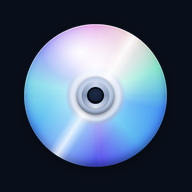
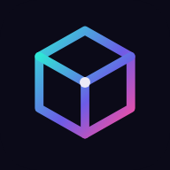
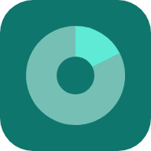
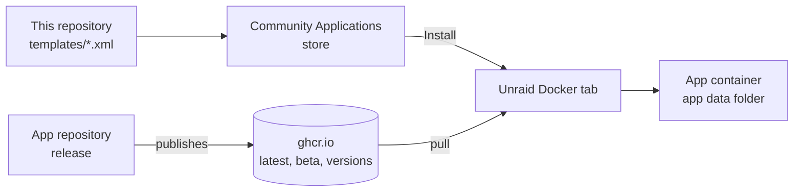
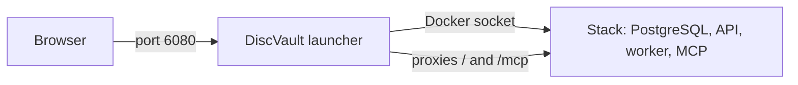

<div align="center">

<picture>
  <source media="(prefers-color-scheme: dark)" srcset="icons/helmerznl.png">
  
</picture>

# Unraid Community Applications templates by Helmer

**The self-hosted apps of helmerzNL and Flux76, ready to install from the Unraid app store.**

Templates for the [Unraid](https://unraid.net) Community Applications store: DiscVault, 3D Print Pricing, MealieShopper, Doorbell Map and NAS Storage Analyzer, each as a stable and a beta app that run side by side.

🇬🇧 **English** · 🇳🇱 [Nederlands](README.nl.md)

[](#getting-started)
[](#the-apps)
[](#features)

[](https://github.com/helmerzNL/unraid-community-apps/commits)
[](https://github.com/helmerzNL/unraid-community-apps/graphs/commit-activity)
[](LICENSE)
[](https://github.com/helmerzNL/unraid-community-apps/forks)
[](https://github.com/helmerzNL/unraid-community-apps/stargazers)
[](https://github.com/helmerzNL/unraid-community-apps/issues)
[](https://github.com/helmerzNL/unraid-community-apps/graphs/contributors)

[](https://buymeacoffee.com/flux76)
[](https://ko-fi.com/flux76)

[Templates](templates/) · [Home Assistant version](https://github.com/helmerzNL/home-assistant-addons) · [Report a bug](https://github.com/helmerzNL/unraid-community-apps/issues/new/choose)

<table>
  <tr>
    <td align="center" valign="top" width="20%"><a href="https://github.com/helmerzNL/DiscVault"><br><b>DiscVault</b></a><br><sub>4K UHD, Blu-ray and DVD collection</sub></td>
    <td align="center" valign="top" width="20%"><a href="https://github.com/Flux76HQ/3dprint_pricing"><br><b>3D Print Pricing</b></a><br><sub>Cost price and inventory for 3D printing</sub></td>
    <td align="center" valign="top" width="20%"><a href="https://github.com/helmerzNL/MealieShopper"><br><b>MealieShopper</b></a><br><sub>Week menu to supermarket basket</sub></td>
    <td align="center" valign="top" width="20%"><a href="https://github.com/helmerzNL/Doorbell-Map"><br><b>Doorbell Map</b></a><br><sub>Neighbourhood map for door-to-door events</sub></td>
    <td align="center" valign="top" width="20%"><a href="https://github.com/helmerzNL/NAS-Storage-Analyzer"><br><b>NAS Storage Analyzer</b></a><br><sub>Read-only storage analysis of your shares</sub></td>
  </tr>
</table>

</div>

---

## Contents

- [Why Unraid Community Applications templates by Helmer?](#why-unraid-community-applications-templates-by-helmer)
- [Features](#features)
- [The apps](#the-apps)
- [Getting started](#getting-started)
- [Configuration](#configuration)
- [Running it](#running-it)
- [Data and backups](#data-and-backups)
- [Architecture](#architecture)
- [Stable and beta](#stable-and-beta)
- [Contributing](#contributing)
- [Privacy and security](#privacy-and-security)
- [Support Unraid Community Applications templates by Helmer](#support-unraid-community-applications-templates-by-helmer)
- [License](#license)

## Why Unraid Community Applications templates by Helmer?

Every one of these apps ships a Docker Compose file, but on Unraid you install apps from the Community Applications store, with a form
instead of a YAML file. These templates fill in that form for you: the image, the port, the app data folder and the few settings that
matter, with an explanation in English and Dutch. Every app also has a beta template with its own folder and port, so you can try what is
coming without touching your stable installation.

## Features

- **Five apps in one place**: DiscVault, 3D Print Pricing, MealieShopper, Doorbell Map and NAS Storage Analyzer, all in the store as *Helmer's Repository*.
- **Stable and beta side by side**: every beta has its own name, app data folder and port, so both run at the same time.
- **Few fields to fill in**: sensible defaults, required fields only where an app cannot do without, and every secret masked in the form.
- **Updates without waiting for this repository**: the templates follow the moving tags `latest` and `beta`, so a new release of an app
  reaches you through Unraid's own update check.
- **DiscVault with its database**: its template installs the DiscVault launcher, which sets up PostgreSQL and the rest of the stack for you.
- **amd64 and arm64**: every image is public and built for both.
- **Your data, your server**: every app runs in its own container and keeps its data in its own appdata folder.

## The apps

| App | What it does | Image | Port | App data |
|---|---|---|---|---|
| [**DiscVault**](templates/discvault.xml) | Manager for your 4K UHD, Blu-ray and DVD collection (installs the DiscVault launcher, see [Architecture](#architecture)) | `ghcr.io/helmerznl/discvault-launcher:latest` | 6080 | `/mnt/user/appdata/discvault`, `discvault-postgres`, `discvault-launcher` |
| [**DiscVault (beta)**](templates/discvault-beta.xml) | The development version | `ghcr.io/helmerznl/discvault-launcher:beta` | 6081 | `/mnt/user/appdata/discvault-beta`, `discvault-beta-postgres`, `discvault-beta-launcher` |
| [**3D Print Pricing**](templates/printpricing.xml) | Cost price calculator and inventory for a 3D-print business | `ghcr.io/flux76hq/3dprint_pricing:latest` | 6280 | `/mnt/cache/appdata/printpricing` |
| [**3D Print Pricing (beta)**](templates/printpricing-beta.xml) | The development version | `ghcr.io/flux76hq/3dprint_pricing:beta` | 6281 | `/mnt/cache/appdata/printpricing-beta` |
| [**MealieShopper**](templates/mealieshopper.xml) | Week menu from Mealie to your supermarket basket | `ghcr.io/helmerznl/mealieshopper:latest` | 5959 | `/mnt/user/appdata/mealieshopper` |
| [**MealieShopper (beta)**](templates/mealieshopper-beta.xml) | The development version | `ghcr.io/helmerznl/mealieshopper:beta` | 5960 | `/mnt/user/appdata/mealieshopper-beta` |
| [**Doorbell Map**](templates/doorbell-map.xml) | Neighbourhood map of houses that do or do not want a visit | `ghcr.io/helmerznl/doorbell-map:latest` | 9888 | `/mnt/user/appdata/doorbell-map` |
| [**Doorbell Map (beta)**](templates/doorbell-map-beta.xml) | The development version | `ghcr.io/helmerznl/doorbell-map:beta` | 9889 | `/mnt/user/appdata/doorbell-map-beta` |
| [**NAS Storage Analyzer**](templates/nas-storage-analyzer.xml) | Read-only storage analysis of your shares, per share, folder and file type | `ghcr.io/helmerznl/nas-storage-analyzer-aio:latest` | 6480 | `/mnt/cache/appdata/nas-storage-analyzer` |
| [**NAS Storage Analyzer (beta)**](templates/nas-storage-analyzer-beta.xml) | The development version | `ghcr.io/helmerznl/nas-storage-analyzer-aio:beta` | 6481 | `/mnt/cache/appdata/nas-storage-analyzer-beta` |

All images are public and built for amd64 and arm64. **3D Print Pricing** is one container: since version 0.26.23 its database is a SQLite
file in the app data folder, so nothing else has to be installed. Its host port is 6280 (the container listens on 6080) because DiscVault
uses 6080.

## Getting started

### From the store

1. In Unraid open **Apps** and search for the app; the beta versions have *(beta)* in their name.
2. Choose **Install** and fill in the (few) required fields, see [Configuration](#configuration).
3. Apply, then open the web interface from the app's icon on the **Docker** tab.

### By hand

Download the XML file you want from [`templates/`](templates) into `/boot/config/plugins/dockerMan/templates-user/` on your Unraid server,
then on the **Docker** tab choose *Add Container* and pick the template from the *Template* list.

### First start

- **DiscVault**: the first start takes a few minutes while the launcher pulls the images and creates the database. Then go through the
  onboarding and create your passkey (or, with password sign-in turned on, your username, password and authenticator app).
- **3D Print Pricing**: open the app and go through the onboarding: the setup code you filled in, your name, a passkey or a password, and
  the recovery codes. A password works on any address, passkeys need an https address with a domain name.
- **MealieShopper**: on the first start it guides you through security and the links with Mealie and your supermarkets.
- **Doorbell Map**: open the map followed by `/beheer`, type the setup code and choose a username with a password or, on an https address, a
  passkey. A password works on any address, also `http://<server>:9888` on your own network; passkeys need an https address with a domain name.
- **NAS Storage Analyzer**: read the setup token in the log (look for `setup_token`), open `http://<server>:6480`, create the administrator with
  a password and an authenticator app, and add your shares by their path, for example `/mnt/user/media`.

## Configuration

Everything is set in the template form, where every field explains itself. What each app needs:

| App | Required | Worth knowing |
|---|---|---|
| DiscVault | The folders (the defaults are fine) and **Timezone** (`TZ`) | For passkeys: **Passkey domain** (`RP_ID`) and **Passkey addresses** (`RP_ORIGINS`); empty means localhost, which only works on the server itself. **Password sign-in** (`LEGACY_AUTH_ENABLED`) is opt-in. Left empty, the PostgreSQL password and the JWT secret are made by the launcher on the first start, in `/config/stack.env`. The launcher does not pass the `DISCVAULT_OIDC_*` variables on yet, so the template does not offer OpenID Connect. |
| 3D Print Pricing | **App data** on a local disk (see [Data and backups](#data-and-backups)), **Setup code** (`SETUP_CODE`) and **Session secret** (`SESSION_SECRET`). Both have no default: make them with `openssl rand -hex 8` and `openssl rand -hex 32` | For passkeys: `RP_ID` and `RP_ORIGINS`. Push notifications need a VAPID key pair; the field explains how to make one. |
| MealieShopper | Nothing | Every field is optional: on the first start the app guides you through security and the links with Mealie. A Mealie link made in the app takes precedence over the fields. |
| NAS Storage Analyzer | **App data** on a local disk and **Encryption key** (`NASSA_ENCRYPTION_KEY`, make it with `openssl rand -base64 32` and keep a copy: it seals the stored SMB passwords) | The shares under `/mnt/user` are passed in read-only at the same path; **Shares group** (`NASSA_SHARES_GID`, 100) lets the app read shares of `nobody:users`. The container runs PostgreSQL, the web interface and the scan worker together (the app's all-in-one image) and gets `--shm-size=256m`. Passkeys need **Passkey domain** and **Passkey addresses** and https. |
| Doorbell Map | **Setup code** (`SETUP_TOKEN`, at least 16 characters, for example `openssl rand -hex 12`) and **Session secret** (`SESSION_SECRET`, for example `openssl rand -hex 32`) | **Origin** (`ORIGIN`) is optional since version 1.0.35: empty, the map follows the address it is opened on; fill it in (exactly as in the address bar) when it should only work on that one address. **Passkey domain** (`RP_ID`) is optional too: empty means the host name of Origin or of the address in the browser, which is almost always right. |

Keep a session secret fixed once it is set: a new value signs everyone out.

## Running it

| Task | How |
|---|---|
| Start, stop, restart | **Docker** tab: click the app's icon |
| Update | **Docker** tab: *Check for updates*, then apply the update of the app. DiscVault's launcher also updates the rest of its stack when it starts |
| Roll back | Edit the container and set **Repository** to a version tag instead of `latest`; the tags are on the app's package page (the *Registry* link of the template). DiscVault: set **Release channel** to `manual` and the tag (for example `v26.10.17`) in **DiscVault image** |
| Logs | **Docker** tab: the app's icon, then *Logs* |

- **Health check:** DiscVault answers on `/api/next/health`, 3D Print Pricing and MealieShopper on `/healthz`, Doorbell Map on `/api/auth/status`, NAS Storage Analyzer on `/readyz`.
- **Largest upload:** 3D Print Pricing accepts STL and 3MF files up to 50 MB (**Largest upload (MB)**, `MAX_UPLOAD_MB`). Whatever runs in
  front of an app (a reverse proxy, a CDN) must allow at least that much. The other apps state their limits in their own README.
- **Update check:** 3D Print Pricing and MealieShopper tell the owner when a newer release exists; they never update themselves and send
  nothing about your installation. Both can switch it off in the template.

A release that changed the database may not run on an older version: roll back by restoring the backup from before the update.

## Data and backups

Every app keeps everything in its own app data folder (see [The apps](#the-apps)); a beta has its own.

| App | What is in it |
|---|---|
| DiscVault | `discvault`: posters, profiles and backups. `discvault-postgres`: the PostgreSQL database. `discvault-launcher`: the launcher's state, the generated Compose file, the generated secrets and the boot logs |
| 3D Print Pricing | `db/`: the database, one SQLite file. `uploads/`: the uploaded STL and 3MF files |
| MealieShopper | The database and `secret.key` |
| Doorbell Map | The houses, the users and their passwords and passkeys, settings and the app's automatic backups |
| NAS Storage Analyzer | `postgres/`: the PostgreSQL database. The encryption key is not in it: keep it with your template settings |

The folders of 3D Print Pricing and NAS Storage Analyzer must be on a **local disk, not on `/mnt/user`**: a database does not belong on that FUSE
share (SQLite can lose data there, PostgreSQL slows down), which is why both templates default to the cache pool (`/mnt/cache/appdata/<app>`;
use `/mnt/diskN/appdata/...` without a cache pool). The container of 3D Print Pricing warns at start-up when the folder is on such a file system.

**Backup:** copy an app's folders while the app is stopped, by hand or with the appdata backup you already use; a running database is not a
consistent copy. For DiscVault that includes the containers of its stack, PostgreSQL among them. DiscVault and 3D Print Pricing also have a
backup in the app itself (DiscVault: **Admin → Backup**, also on a schedule; 3D Print Pricing: *Settings → System*), which is also the way to
move an installation to or from Docker Compose or Home Assistant.

**Restore:** stop the app, put its folders back and start it again, or use the restore in the app.

The 3D Print Pricing template is for new installations; an existing installation on the PostgreSQL releases is moved over by the app
itself, see its operations guide (*Overstap naar SQLite*).

## Architecture



A template is a form for one container: which image, which port, which folders and which variables. The image itself comes from the app's
own repository, which builds and publishes it; this repository only describes how to run it on Unraid.

**DiscVault** needs a PostgreSQL database next to the app, and the store cannot declare such a dependency. So its template installs the
[DiscVault launcher](https://github.com/helmerzNL/DiscVault-Launcher): one container that creates and updates the whole stack (PostgreSQL,
API, worker, MCP) through the Docker socket and serves it on one port. That socket gives the launcher control over Docker on your server;
the template says so.



| Part | Purpose |
|---|---|
| `templates/<app>.xml` | The stable template of an app, edited by hand |
| `templates/<app>-beta.xml` | The beta template, generated from the stable one |
| `icons/` | The app icons the store shows, and `helmerznl.png` for the maintainer profile |
| `ca_profile.xml` | The maintainer profile in the store |
| `sources.json` | Per app: its repository, its image and what the beta template changes |
| `scripts/`, `tests/` | The checks and the beta generator, run by CI on every pull request |

## Stable and beta

| | Stable | Beta |
|---|---|---|
| Template | `templates/<app>.xml` | `templates/<app>-beta.xml`, generated |
| Image tag | `latest` | `beta` |
| In the store | *DiscVault* | *DiscVault (beta)*, marked as beta |
| Port | the app's port | one higher |
| App data | `.../appdata/<app>` | `.../appdata/<app>-beta` |

A beta can change the database in ways the stable version cannot read: never point it at the data folder of the stable app. DiscVault's
beta also has its own Compose project name and network, so both stacks run side by side. The templates use the moving tags, so a new release
of an app needs no change here: the app's own repository decides what `latest` and `beta` are.

## Contributing

Contributions are welcome. Pull requests go to `main`, the branch the store reads. For bugs and ideas about the templates, open an
[issue](https://github.com/helmerzNL/unraid-community-apps/issues/new/choose); a problem in an app itself belongs with that app (the
*Support* link of its template).

```bash
python scripts/check_templates.py              # every template complete, secrets masked, unique names and ports, English and Dutch
python scripts/check_templates.py --registry   # also: do the latest and beta tags exist on ghcr.io (needs the network)
python scripts/derive_beta.py --check          # the beta templates match their stable templates (without --check: regenerate)
python -m unittest discover -s tests
xmllint --noout templates/*.xml ca_profile.xml
```

Edit only the stable template of an app; the beta template is generated by `scripts/derive_beta.py` (name, `beta` tag, the `Beta` flag the store labels,
own folder, port plus one, a hidden variable that shows the BETA label, and a notice). CI fails when a beta template has drifted.

### Versions

The templates use the floating tags `latest` and `beta`, so Unraid offers an update by itself as soon as a new image of an app is published;
installed containers need no change here. What does change is the `<Changes>` field of each template, the change log the store shows: its
newest entry names the version that template delivers. `scripts/sync_versions.py` writes it, and only once the image of that version is
published (`sources.json`, under `versions`, says which release tags and which image belong to an app). A beta follows the moving `beta` image,
which has no version of its own, so its entry is `<newest release>-beta.<build time>` (for example `1.0.34-beta.202611031626`, the same name
the Home Assistant add-ons use) with a link to what changed since that release. `derive_beta.py` keeps the beta template's own `<Changes>`.

Every 6 hours a scheduled Claude Code task runs the script on `main` and opens, or updates, one pull request from the branch
`automation/update-versions`; merge it to publish the new versions in the store.

```bash
python scripts/sync_versions.py --check        # which versions would be recorded
python scripts/sync_versions.py                # record them
```

To add an app: add it to `sources.json` (with its `versions`), write `templates/<key>.xml` (copy an existing one), put its icon in `icons/<key>.png`, run
`scripts/derive_beta.py` and `scripts/check_templates.py`.

### The store listing (owner only)

The repository is in the store as *Helmer's Repository*: a template added or changed on `main` appears after the next catalogue build. To
submit it again:

1. Make sure the repository is public, has a `LICENSE` and `ca_profile.xml` (it does) and that two-factor authentication is on for GitHub.
2. Open <https://ca.unraid.net/submit>, start a submission for this repository, run **Validate** and **Scan**, and fix what they report here.
3. Submit. A support thread on the Unraid forum is recommended but not required; when an app has one (DiscVault does), its URL goes into
   the `Support` field of that app's template.

## Privacy and security

- The apps run on your own server: no account with us, no analytics, no tracking. The templates add nothing that contacts anyone; what an
  app connects to is described in its own README.
- Every secret is masked in the form; `scripts/check_templates.py` fails a template with an unmasked secret field.
- The DiscVault launcher mounts the Docker socket, which gives it control over Docker on your server.
- NAS Storage Analyzer gets `/mnt/user` read-only: it lists folders and reads sizes and dates, and cannot change anything on your shares.
- For access from outside, put a reverse proxy with https in front of an app; passkeys need an https address with a domain name anyway.
- Report a vulnerability privately through a [security advisory](https://github.com/helmerzNL/unraid-community-apps/security/advisories/new),
  never in a public issue.

## Support Unraid Community Applications templates by Helmer

The templates and the apps are free. If they are useful to you, a coffee keeps the development going.

<a href="https://buymeacoffee.com/flux76"></a>
<a href="https://ko-fi.com/flux76"></a>

## License

[MIT](LICENSE) © 2026 Helmer Zandbergen. The licence covers the templates and scripts in this repository, not the apps they install.

---

<div align="center">
<sub>Made with ❤️ in the Netherlands by <a href="https://flux76.com">Flux76</a></sub>
</div>
