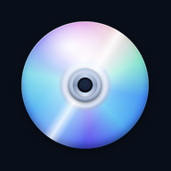
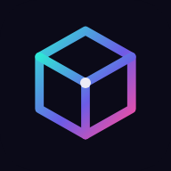
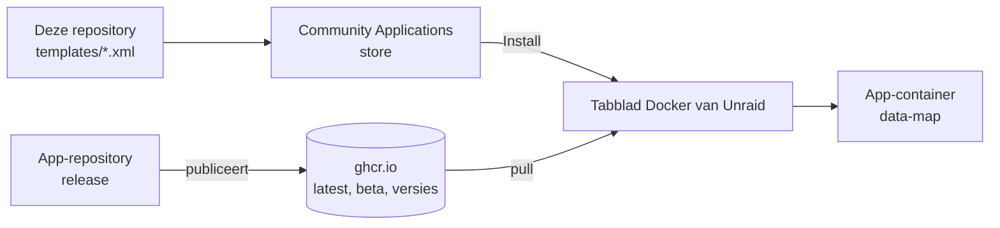
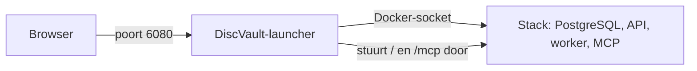

<div align="center">

<picture>
  <source media="(prefers-color-scheme: dark)" srcset="icons/helmerznl.png">
  
</picture>

# Unraid Community Applications templates by Helmer

**De zelf te hosten apps van helmerzNL en Flux76, klaar om te installeren uit de app-store van Unraid.**

Templates voor de [Unraid](https://unraid.net) Community Applications-store: DiscVault, 3D Print Pricing, MealieShopper en Doorbell Map, elk als stabiele en als beta-app die naast elkaar draaien.

🇳🇱 **Nederlands** · 🇬🇧 [English](README.md)

[](#snel-starten)
[](#de-apps)
[](#wat-kan-het)

[](https://github.com/helmerzNL/unraid-community-apps/commits)
[](https://github.com/helmerzNL/unraid-community-apps/graphs/commit-activity)
[](LICENSE)
[](https://github.com/helmerzNL/unraid-community-apps/forks)
[](https://github.com/helmerzNL/unraid-community-apps/stargazers)
[](https://github.com/helmerzNL/unraid-community-apps/issues)
[](https://github.com/helmerzNL/unraid-community-apps/graphs/contributors)

[](https://buymeacoffee.com/flux76)
[](https://ko-fi.com/flux76)

[Templates](templates/) · [Home Assistant-versie](https://github.com/helmerzNL/home-assistant-addons) · [Een fout melden](https://github.com/helmerzNL/unraid-community-apps/issues/new/choose)

<table>
  <tr>
    <td align="center" valign="top" width="25%"><a href="https://github.com/helmerzNL/DiscVault"><br><b>DiscVault</b></a><br><sub>Collectie van 4K UHD, Blu-ray en dvd</sub></td>
    <td align="center" valign="top" width="25%"><a href="https://github.com/Flux76HQ/3dprint_pricing"><br><b>3D Print Pricing</b></a><br><sub>Kostprijs en voorraad voor 3D-printen</sub></td>
    <td align="center" valign="top" width="25%"><a href="https://github.com/helmerzNL/MealieShopper"><br><b>MealieShopper</b></a><br><sub>Van weekmenu naar boodschappenmandje</sub></td>
    <td align="center" valign="top" width="25%"><a href="https://github.com/helmerzNL/Doorbell-Map"><br><b>Doorbell Map</b></a><br><sub>Wijkkaart voor deur-aan-deuracties</sub></td>
  </tr>
</table>

</div>

---

## Inhoud

- [Waarom Unraid Community Applications templates by Helmer?](#waarom-unraid-community-applications-templates-by-helmer)
- [Wat kan het?](#wat-kan-het)
- [De apps](#de-apps)
- [Snel starten](#snel-starten)
- [Configuratie](#configuratie)
- [Beheer](#beheer)
- [Data en back-ups](#data-en-back-ups)
- [Architectuur](#architectuur)
- [Stabiel en beta](#stabiel-en-beta)
- [Meewerken](#meewerken)
- [Privacy en beveiliging](#privacy-en-beveiliging)
- [Steun Unraid Community Applications templates by Helmer](#steun-unraid-community-applications-templates-by-helmer)
- [Licentie](#licentie)

## Waarom Unraid Community Applications templates by Helmer?

Elk van deze apps heeft een Docker Compose-bestand, maar op Unraid installeer je apps uit de Community Applications-store, met een formulier
in plaats van een YAML-bestand. Deze templates vullen dat formulier voor je in: het image, de poort, de data-map en de paar instellingen die
ertoe doen, met uitleg in het Engels en het Nederlands. Elke app heeft ook een beta-template met een eigen map en poort, zodat je kunt
proberen wat eraan komt zonder aan je stabiele installatie te komen.

## Wat kan het?

- **Vier apps op één plek**: DiscVault, 3D Print Pricing, MealieShopper en Doorbell Map, allemaal in de store als *Helmer's Repository*.
- **Stabiel en beta naast elkaar**: elke beta heeft een eigen naam, data-map en poort, zodat beide tegelijk draaien.
- **Weinig in te vullen**: verstandige standaardwaarden, verplichte velden alleen waar een app niet zonder kan, en elk geheim gemaskeerd in
  het formulier.
- **Updates zonder op deze repository te wachten**: de templates volgen de meebewegende tags `latest` en `beta`, dus een nieuwe release van
  een app bereikt je via de eigen updatecheck van Unraid.
- **DiscVault met zijn database**: de template installeert de DiscVault-launcher, die PostgreSQL en de rest van de stack voor je opzet.
- **amd64 en arm64**: elk image is publiek en voor beide gebouwd.
- **Jij houdt de regie**: elke app draait in een eigen container en bewaart zijn gegevens in een eigen appdata-map.

## De apps

| App | Wat het doet | Image | Poort | Data-map |
|---|---|---|---|---|
| [**DiscVault**](templates/discvault.xml) | Beheer van je collectie 4K UHD, Blu-ray en dvd (installeert de DiscVault-launcher, zie [Architectuur](#architectuur)) | `ghcr.io/helmerznl/discvault-launcher:latest` | 6080 | `/mnt/user/appdata/discvault`, `discvault-postgres`, `discvault-launcher` |
| [**DiscVault (beta)**](templates/discvault-beta.xml) | De ontwikkelversie | `ghcr.io/helmerznl/discvault-launcher:beta` | 6081 | `/mnt/user/appdata/discvault-beta`, `discvault-beta-postgres`, `discvault-beta-launcher` |
| [**3D Print Pricing**](templates/printpricing.xml) | Kostprijscalculator en voorraadbeheer voor een 3D-printbedrijf | `ghcr.io/flux76hq/3dprint_pricing:latest` | 6280 | `/mnt/cache/appdata/printpricing` |
| [**3D Print Pricing (beta)**](templates/printpricing-beta.xml) | De ontwikkelversie | `ghcr.io/flux76hq/3dprint_pricing:beta` | 6281 | `/mnt/cache/appdata/printpricing-beta` |
| [**MealieShopper**](templates/mealieshopper.xml) | Van weekmenu in Mealie naar je boodschappenmandje | `ghcr.io/helmerznl/mealieshopper:latest` | 5959 | `/mnt/user/appdata/mealieshopper` |
| [**MealieShopper (beta)**](templates/mealieshopper-beta.xml) | De ontwikkelversie | `ghcr.io/helmerznl/mealieshopper:beta` | 5960 | `/mnt/user/appdata/mealieshopper-beta` |
| [**Doorbell Map**](templates/doorbell-map.xml) | Wijkkaart van huizen die wel of geen bezoek aan de deur willen | `ghcr.io/helmerznl/doorbell-map:latest` | 9888 | `/mnt/user/appdata/doorbell-map` |
| [**Doorbell Map (beta)**](templates/doorbell-map-beta.xml) | De ontwikkelversie | `ghcr.io/helmerznl/doorbell-map:beta` | 9889 | `/mnt/user/appdata/doorbell-map-beta` |

Alle images zijn publiek en gebouwd voor amd64 en arm64. **3D Print Pricing** is één container: sinds versie 0.26.23 is de database een
SQLite-bestand in de data-map, dus er hoeft niets anders geïnstalleerd te worden. De hostpoort is 6280 (de container luistert op 6080) omdat
DiscVault 6080 gebruikt.

## Snel starten

### Uit de store

1. Open in Unraid **Apps** en zoek de app; de beta-versies hebben *(beta)* in hun naam.
2. Kies **Install** en vul de (weinige) verplichte velden in, zie [Configuratie](#configuratie).
3. Pas toe en open daarna de webinterface via het icoon van de app op het tabblad **Docker**.

### Met de hand

Download het XML-bestand dat je wilt uit [`templates/`](templates) naar `/boot/config/plugins/dockerMan/templates-user/` op je
Unraid-server, kies daarna op het tabblad **Docker** *Add Container* en kies de template in de lijst *Template*.

### Eerste start

- **DiscVault**: de eerste start duurt een paar minuten, terwijl de launcher de images ophaalt en de database aanmaakt. Doorloop daarna de
  onboarding en maak je passkey (of, met wachtwoordinlog aan, je gebruikersnaam, wachtwoord en authenticator-app).
- **3D Print Pricing**: open de app en doorloop de onboarding: de setupcode die je invulde, je naam, een passkey of een wachtwoord, en de
  herstelcodes. Een wachtwoord werkt op elk adres, passkeys vragen om een https-adres met een domeinnaam.
- **MealieShopper**: bij de eerste start loopt hij je door de beveiliging en de koppelingen met Mealie en je supermarkten.
- **Doorbell Map**: open de kaart met `/beheer` erachter, typ de setupcode en kies een gebruikersnaam met een wachtwoord of, op een https-adres,
  een passkey. Een wachtwoord werkt op elk adres, ook `http://<server>:9888` in je eigen netwerk; passkeys vragen om een https-adres met een domeinnaam.

## Configuratie

Alles stel je in het formulier van de template in, waar elk veld zichzelf uitlegt. Wat elke app nodig heeft:

| App | Verplicht | Goed om te weten |
|---|---|---|
| DiscVault | De mappen (de standaardwaarden zijn prima) en **Timezone** (`TZ`) | Voor passkeys: **Passkey domain** (`RP_ID`) en **Passkey addresses** (`RP_ORIGINS`); leeg betekent localhost, en dat werkt alleen op de server zelf. **Password sign-in** (`LEGACY_AUTH_ENABLED`) zet je zelf aan. Blijven ze leeg, dan maakt de launcher het PostgreSQL-wachtwoord en het JWT-geheim bij de eerste start, in `/config/stack.env`. De launcher geeft de `DISCVAULT_OIDC_*`-variabelen nog niet door, dus de template biedt OpenID Connect niet aan. |
| 3D Print Pricing | **App data** op een lokale schijf (zie [Data en back-ups](#data-en-back-ups)), **Setup code** (`SETUP_CODE`) en **Session secret** (`SESSION_SECRET`). Beide hebben geen standaardwaarde: maak ze met `openssl rand -hex 8` en `openssl rand -hex 32` | Voor passkeys: `RP_ID` en `RP_ORIGINS`. Pushmeldingen vragen om een VAPID-sleutelpaar; het veld legt uit hoe je dat maakt. |
| MealieShopper | Niets | Elk veld is optioneel: bij de eerste start loopt de app je door de beveiliging en de koppeling met Mealie. Een koppeling met Mealie die je in de app maakt, gaat voor de velden. |
| Doorbell Map | **Setup code** (`SETUP_TOKEN`, minstens 16 tekens, bijvoorbeeld `openssl rand -hex 12`) en **Session secret** (`SESSION_SECRET`, bijvoorbeeld `openssl rand -hex 32`) | **Origin** (`ORIGIN`) is optioneel sinds versie 1.0.35: leeg volgt de kaart het adres waarop hij wordt geopend; vul hem in (precies zoals in de adresbalk) als hij alleen op dat adres hoort te werken. Ook **Passkey domain** (`RP_ID`) is optioneel: leeg betekent de hostnaam van Origin of van het adres in de browser, en dat klopt bijna altijd. |

Houd een session secret vast als hij eenmaal is ingesteld: een nieuwe waarde logt iedereen uit.

## Beheer

| Taak | Hoe |
|---|---|
| Starten, stoppen, herstarten | Tabblad **Docker**: klik op het icoon van de app |
| Bijwerken | Tabblad **Docker**: *Check for updates*, pas daarna de update van de app toe. De launcher van DiscVault werkt bij het starten ook de rest van zijn stack bij |
| Terug naar de vorige versie | Bewerk de container en zet bij **Repository** een versietag in plaats van `latest`; de tags staan op de pakketpagina van de app (de *Registry*-link van de template). DiscVault: zet **Release channel** op `manual` en de tag (bijvoorbeeld `v26.10.17`) bij **DiscVault image** |
| Logboek | Tabblad **Docker**: het icoon van de app, dan *Logs* |

- **Health check:** DiscVault antwoordt op `/api/next/health`, 3D Print Pricing en MealieShopper op `/healthz`, Doorbell Map op `/api/auth/status`.
- **Grootste upload:** 3D Print Pricing accepteert STL- en 3MF-bestanden tot 50 MB (**Largest upload (MB)**, `MAX_UPLOAD_MB`). Wat voor een
  app staat (een reverse proxy, een CDN) moet minstens zoveel toelaten. De andere apps noemen hun grens in hun eigen README.
- **Updatecheck:** 3D Print Pricing en MealieShopper melden de eigenaar dat er een nieuwere release is; ze werken zichzelf nooit bij en
  sturen niets over je installatie mee. Bij beide zet je hem in de template uit.

Een release die de database heeft gewijzigd, draait misschien niet op een oudere versie: ga dan terug door de back-up van voor de update
terug te zetten.

## Data en back-ups

Elke app bewaart alles in zijn eigen data-map (zie [De apps](#de-apps)); een beta heeft een eigen map.

| App | Wat erin staat |
|---|---|
| DiscVault | `discvault`: posters, profielen en back-ups. `discvault-postgres`: de PostgreSQL-database. `discvault-launcher`: de status van de launcher, het gegenereerde Compose-bestand, de gegenereerde geheimen en de opstartlogboeken |
| 3D Print Pricing | `db/`: de database, één SQLite-bestand. `uploads/`: de geüploade STL- en 3MF-bestanden |
| MealieShopper | De database en `secret.key` |
| Doorbell Map | De huizen, de gebruikers met hun wachtwoorden en passkeys, instellingen en de automatische back-ups van de app |

De map van 3D Print Pricing moet op een **lokale schijf staan, niet op `/mnt/user`**: SQLite kan op die FUSE-share gegevens verliezen.
Daarom staat de template standaard op de cachepool (`/mnt/cache/appdata/printpricing`; zonder cachepool `/mnt/diskN/appdata/...`). De
container waarschuwt bij het starten als de map op zo'n bestandssysteem staat.

**Back-up:** kopieer de mappen van een app terwijl de app gestopt is, met de hand of met de appdata-back-up die je al gebruikt; een draaiende
database is geen consistente kopie. Bij DiscVault horen daar de containers van zijn stack bij, PostgreSQL ook. DiscVault en 3D Print Pricing
hebben ook een back-up in de app zelf (DiscVault: **Beheer → Backup**, ook volgens schema; 3D Print Pricing: *Instellingen → Systeem*); daarmee
verhuis je ook een installatie van of naar Docker Compose of Home Assistant.

**Terugzetten:** stop de app, zet de mappen terug en start hem weer, of gebruik het terugzetten in de app.

De template van 3D Print Pricing is voor nieuwe installaties; een bestaande installatie op de PostgreSQL-releases wordt door de app zelf
overgezet, zie zijn handleiding (*Overstap naar SQLite*).

## Architectuur



Een template is een formulier voor één container: welk image, welke poort, welke mappen en welke variabelen. Het image zelf komt uit de
eigen repository van de app, die het bouwt en publiceert; deze repository beschrijft alleen hoe je het op Unraid draait.

**DiscVault** heeft een PostgreSQL-database naast de app nodig en de store kan zo'n afhankelijkheid niet vastleggen. Daarom installeert de
template de [DiscVault-launcher](https://github.com/helmerzNL/DiscVault-Launcher): een container die de hele stack (PostgreSQL, API, worker,
MCP) via de Docker-socket aanmaakt en bijwerkt en op één poort aanbiedt. Die socket geeft de launcher controle over Docker op je server; de
template zegt dat.



| Onderdeel | Doel |
|---|---|
| `templates/<app>.xml` | De stabiele template van een app, met de hand bijgehouden |
| `templates/<app>-beta.xml` | De beta-template, gegenereerd uit de stabiele |
| `icons/` | De app-iconen die de store toont, en `helmerznl.png` voor het profiel van de maintainer |
| `ca_profile.xml` | Het profiel van de maintainer in de store |
| `sources.json` | Per app: de repository, het image en wat de beta-template anders doet |
| `scripts/`, `tests/` | De controles en de beta-generator, die de CI bij elke pull request draait |

## Stabiel en beta

| | Stabiel | Beta |
|---|---|---|
| Template | `templates/<app>.xml` | `templates/<app>-beta.xml`, gegenereerd |
| Image-tag | `latest` | `beta` |
| In de store | *DiscVault* | *DiscVault (beta)*, gemarkeerd als beta |
| Poort | de poort van de app | één hoger |
| Data-map | `.../appdata/<app>` | `.../appdata/<app>-beta` |

Een beta kan de database aanpassen op een manier die de stabiele versie niet kan lezen: zet een beta nooit op de data-map van de stabiele
app. De beta van DiscVault heeft ook een eigen Compose-projectnaam en netwerk, zodat beide stacks naast elkaar draaien. De templates gebruiken
de meebewegende tags, dus een nieuwe release van een app vraagt hier niets: de repository van de app bepaalt wat `latest` en `beta` zijn.

## Meewerken

Bijdragen zijn welkom. Pull requests gaan naar `main`, de branch die de store leest. Voor fouten en ideeën over de templates open je een
[issue](https://github.com/helmerzNL/unraid-community-apps/issues/new/choose); een probleem in een app zelf hoort bij die app (de
*Support*-link van zijn template).

```bash
python scripts/check_templates.py              # elke template compleet, geheimen gemaskeerd, unieke namen en poorten, Engels en Nederlands
python scripts/check_templates.py --registry   # ook: bestaan de tags latest en beta op ghcr.io (vraagt netwerk)
python scripts/derive_beta.py --check          # de beta-templates kloppen met hun stabiele templates (zonder --check: opnieuw maken)
python -m unittest discover -s tests
xmllint --noout templates/*.xml ca_profile.xml
```

Pas alleen de stabiele template van een app aan; de beta-template wordt gegenereerd door `scripts/derive_beta.py` (naam, `beta`-tag, de
`Beta`-vlag waarmee de store hem labelt, eigen map, poort plus één, een verborgen variabele die het BETA-label laat zien, en een melding). De CI
faalt als een beta-template is afgedreven.

### Versies

De templates gebruiken de meebewegende tags `latest` en `beta`, dus Unraid biedt een update
zelf aan zodra er een nieuw image is. Wat wel bijgewerkt wordt is het veld `<Changes>`, het wijzigingslogboek dat de store toont: de bovenste regel
noemt de versie die de template levert. `scripts/sync_versions.py` schrijft dat, pas als het image van die versie gepubliceerd is; voor een beta is
dat `<nieuwste release>-beta.<bouwtijd>`, met een link naar wat er sinds die release veranderde. `derive_beta.py` bewaart het eigen veld `<Changes>`
van de beta-template. Elke 6 uur draait een geplande Claude Code-taak het
script op `main` en opent of werkt één pull request bij vanaf de branch `automation/update-versions`; merge die om de versies in de store te zetten.

```bash
python scripts/sync_versions.py --check        # welke versies zouden worden vastgelegd
python scripts/sync_versions.py                # leg ze vast
```

Een app toevoegen: zet hem in `sources.json` (met zijn `versions`), schrijf `templates/<key>.xml` (kopieer een bestaande), zet het icoon in `icons/<key>.png` en
draai `scripts/derive_beta.py` en `scripts/check_templates.py`.

### De vermelding in de store (alleen de eigenaar)

De repository staat in de store als *Helmer's Repository*: een template die op `main` is toegevoegd of gewijzigd, verschijnt na de volgende
cataloguscompilatie. Opnieuw indienen:

1. Zorg dat de repository publiek is, een `LICENSE` en `ca_profile.xml` heeft (dat is zo) en dat tweestapsverificatie op GitHub aanstaat.
2. Open <https://ca.unraid.net/submit>, start een inzending voor deze repository, draai **Validate** en **Scan** en los de meldingen hier op.
3. Dien in. Een support-topic op het Unraid-forum is aanbevolen maar niet verplicht; heeft een app er een (DiscVault wel), dan komt de URL in
   het veld `Support` van de template van die app.

## Privacy en beveiliging

- De apps draaien op je eigen server: geen account bij ons, geen analytics, geen tracking. De templates voegen niets toe dat contact maakt
  met wie dan ook; met wie een app verbinding maakt, staat in zijn eigen README.
- Elk geheim is gemaskeerd in het formulier; `scripts/check_templates.py` keurt een template met een ongemaskeerd geheim veld af.
- De DiscVault-launcher krijgt de Docker-socket, en daarmee controle over Docker op je server.
- Zet voor toegang van buitenaf een reverse proxy met https voor een app; passkeys vragen sowieso om een https-adres met een domeinnaam.
- Meld een kwetsbaarheid vertrouwelijk via een [security advisory](https://github.com/helmerzNL/unraid-community-apps/security/advisories/new),
  nooit in een openbaar issue.

## Steun Unraid Community Applications templates by Helmer

De templates en de apps zijn gratis. Heb je er iets aan? Met een koffie houd je de ontwikkeling gaande.

<a href="https://buymeacoffee.com/flux76"></a>
<a href="https://ko-fi.com/flux76"></a>

## Licentie

[MIT](LICENSE) © 2026 Helmer Zandbergen. De licentie geldt voor de templates en scripts in deze repository, niet voor de apps die ze installeren.

---

<div align="center">
<sub>Met ❤️ gemaakt in Nederland door <a href="https://flux76.com">Flux76</a></sub>
</div>
